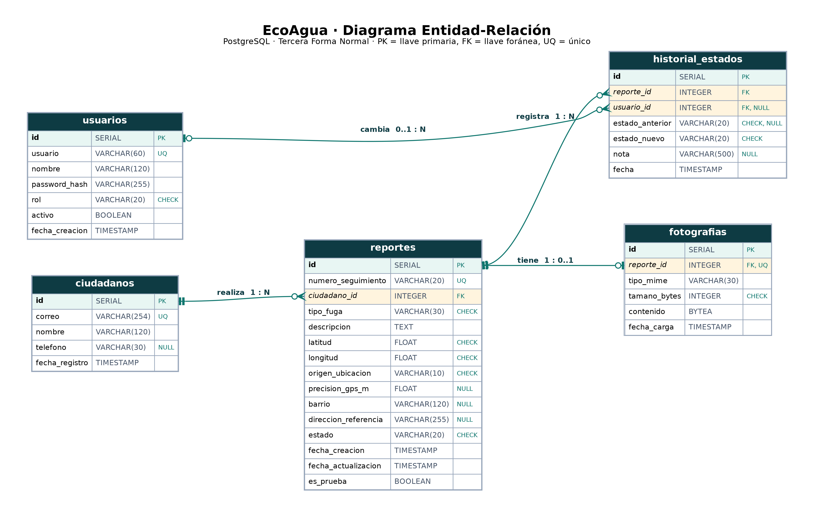

# EcoAgua · Plataforma de reporte de fugas de agua

**ODS abordado:** ODS 6 — Agua limpia y saneamiento (meta 6.4: uso eficiente de los recursos hídricos).

🌐 **Aplicación desplegada:** `https://ecoagua.onrender.com` *(reemplazar por el enlace de Render)*
📁 **Repositorio:** https://github.com/karolinaospina0311-blip/ODS-6-pagina

## 1. Descripción de la solución

EcoAgua permite que la ciudadanía reporte fugas de agua en la vía pública con fotografía y ubicación GPS, y que la empresa de servicios públicos las gestione desde un panel administrativo. Cada reporte recibe un número de seguimiento (`ECO-2026-00001`) con el que el ciudadano consulta su estado (Pendiente → En proceso → Resuelto) y las notas de la empresa.

**Cómo contribuye al ODS 6:** las fugas no reportadas desperdician agua potable durante días. EcoAgua acorta el tiempo entre que alguien ve la fuga y la empresa la atiende, ubica cada fuga con precisión en un mapa, agrupa los reportes por zonas para priorizar las redes más críticas y deja trazabilidad de cada atención. Así reduce el agua no contabilizada y mejora la eficiencia en el uso del recurso hídrico.

### Funcionalidades principales

| Vista | Qué hace |
|---|---|
| Pantalla de inicio (`/`) | Contenido educativo del ODS 6, calculadora de huella hídrica, acceso a reportar y consultar |
| Formulario de reporte (`/#reportar`) | Datos del ciudadano, tipo de fuga, descripción, foto y ubicación (GPS o mapa) |
| Consulta de reporte (`/#consultar`) | Estado, historial y notas del reporte por número de seguimiento |
| Inicio de sesión (`/admin/login`) | Acceso del personal (administrador u operador) |
| Panel principal (`/admin/`) | Estadísticas: totales por estado, zonas críticas, tipos de fuga y evolución diaria |
| Gestión de reportes (`/admin/reportes`) | Búsqueda, filtros, cambio de estado con nota e historial |
| Mapa de reportes (`/admin/mapa`) | Marcadores por estado y zonas con más fugas |
| Gestión / registro de usuarios (`/admin/usuarios`) | Solo administrador: registrar, activar y desactivar usuarios |

### Roles

- **Administrador:** todo el panel y además la gestión de usuarios.
- **Operador (usuario regular):** estadísticas, gestión de reportes y mapa.
- **Ciudadano:** no necesita cuenta; reporta y consulta con su número de seguimiento.

## 2. Integrantes

| Nombre | Rol en el proyecto |
|---|---|
| Karolina García | *(completar)* |
| *(completar)* | *(completar)* |
| *(completar)* | *(completar)* |

## 3. Tecnologías utilizadas

| Capa | Tecnología |
|---|---|
| Frontend | HTML5, CSS3, JavaScript, Jinja2 (plantillas del panel), Leaflet 1.9.4 (mapas), Chart.js 4.4.1 (gráficas) |
| Backend | Python 3.12, Flask 3, Flask-SQLAlchemy / SQLAlchemy 2, Pillow (validación de imágenes), Gunicorn |
| Base de datos | PostgreSQL 16 en producción (Render) · SQLite en desarrollo local |
| Despliegue | Render (servicio web + PostgreSQL), conectado a GitHub con despliegue automático |
| Control de versiones | Git y GitHub |

## 4. Estructura del repositorio

```
ODS6/
├── frontend/                 Interfaz de usuario
│   ├── index.html            Página pública (inicio, reportar, consultar)
│   ├── styles.css, script.js, reportes.js
│   ├── templates/admin/      Vistas del panel (login, estadísticas, reportes, detalle, mapa, usuarios)
│   └── static/               CSS/JS del panel y librerías (Leaflet, Chart.js)
├── backend/                  Lógica de negocio, rutas y conexión a la base de datos
│   ├── app.py                Servidor Flask, API pública y comandos de consola
│   ├── admin.py              Panel: sesión, roles, reportes, mapa, usuarios
│   ├── models.py             Modelos SQL (tablas, llaves y restricciones)
│   ├── servicios.py          Validaciones, fotografías, estados y estadísticas
│   ├── datos_ejemplo.py      Generador de datos de ejemplo
│   └── config.py             Configuración por variables de entorno
├── database/                 Base de datos
│   ├── schema.sql            Esquema (PostgreSQL y SQLite)
│   ├── ecoagua_dump.sql      Copia de respaldo PostgreSQL con datos de ejemplo
│   ├── ecoagua.db            Base SQLite con los mismos datos de ejemplo
│   ├── diagrama_er.png       Diagrama entidad-relación (también en .svg)
├── tests/prueba_flujo.py     Prueba automática del flujo completo
├── .env.example              Variables de entorno (sin valores reales)
├── render.yaml               Configuración de despliegue en Render
└── requirements.txt
```

## 5. Instalación y ejecución local

Requisito: Python 3.10 o superior. Todos los comandos se ejecutan **desde la carpeta raíz** del proyecto.

**Windows (PowerShell):**

```powershell
python -m venv .venv
.venv\Scripts\Activate.ps1
pip install -r requirements.txt
copy .env.example .env          # opcional: editar valores
flask --app backend/app init-db
flask --app backend/app crear-usuario --rol administrador
flask --app backend/app datos-ejemplo      # opcional
flask --app backend/app run
```

**Linux / macOS:**

```bash
python3 -m venv .venv
source .venv/bin/activate
pip install -r requirements.txt
cp .env.example .env            # opcional
flask --app backend/app init-db
flask --app backend/app crear-usuario --rol administrador
flask --app backend/app run
```

Luego abrir http://127.0.0.1:5000 (sitio público) y http://127.0.0.1:5000/admin (panel).

**Usar la base de ejemplo incluida** (SQLite, ya trae usuarios y 30 reportes): en `.env` poner
`DATABASE_URL=sqlite:///database/ecoagua.db` (ruta relativa a la carpeta raíz del proyecto).

**Restaurar la copia PostgreSQL:** crear una base vacía y ejecutar `psql -d ecoagua -f database/ecoagua_dump.sql`.

### Comandos disponibles

| Comando | Uso |
|---|---|
| `flask --app backend/app init-db` | Crea las tablas si no existen |
| `flask --app backend/app crear-usuario` | Crea un usuario (administrador u operador) o cambia su contraseña |
| `flask --app backend/app sembrar` | Crea los usuarios de prueba y datos de ejemplo definidos en variables de entorno |
| `flask --app backend/app datos-ejemplo` | Crea 30 reportes de ejemplo en barrios de Montería |
| `flask --app backend/app borrar-datos-prueba` | Borra solo los reportes marcados como prueba/ejemplo |
| `python tests/prueba_flujo.py` | Prueba automática (86 comprobaciones, usa una base temporal) |

## 6. Variables de entorno

Ver `.env.example`. En Render se configuran en *Environment*; nunca se escriben en el código.

| Variable | Uso | Defecto |
|---|---|---|
| `ECOAGUA_SECRET_KEY` | Clave para firmar sesiones. **Obligatoria en producción** | Se genera en `instance/secret_key` |
| `DATABASE_URL` | Conexión a la base de datos (PostgreSQL en Render) | SQLite en `instance/ecoagua.db` |
| `ECOAGUA_ADMIN_USUARIO` / `ECOAGUA_ADMIN_PASSWORD` | Usuario administrador de prueba (lo crea `sembrar`) | — |
| `ECOAGUA_OPERADOR_USUARIO` / `ECOAGUA_OPERADOR_PASSWORD` | Usuario operador de prueba | — |
| `ECOAGUA_DATOS_EJEMPLO` | `1` crea 30 reportes de ejemplo si la base está vacía | `0` |
| `ECOAGUA_MAPA_LAT`, `ECOAGUA_MAPA_LNG`, `ECOAGUA_MAPA_ZOOM` | Centro inicial de los mapas | Colombia, zoom 6 |
| `ECOAGUA_MAX_FOTO_MB` | Tamaño máximo de foto | `8` |
| `ECOAGUA_FOTO_OBLIGATORIA` | `1` exige foto, `0` la hace opcional | `1` |
| `ECOAGUA_PROXY` | `1` detrás del proxy HTTPS de Render | `0` |
| `ECOAGUA_COOKIE_SEGURA` | `1` cuando el sitio usa HTTPS | `0` |
| `ECOAGUA_ZONA_HORARIA` | Zona horaria de las fechas | `America/Bogota` |

## 7. Despliegue en Render

El archivo `render.yaml` crea todo automáticamente:

1. Subir el código a GitHub (`git push`).
2. En https://dashboard.render.com → **New → Blueprint** → elegir este repositorio.
3. Render muestra la base de datos `ecoagua-db` (PostgreSQL) y el servicio web `ecoagua`. Escribir los valores pedidos: `ECOAGUA_ADMIN_USUARIO`, `ECOAGUA_ADMIN_PASSWORD`, `ECOAGUA_OPERADOR_USUARIO`, `ECOAGUA_OPERADOR_PASSWORD` (contraseñas de 10 caracteres o más).
4. **Apply**. Al arrancar, el servicio crea las tablas, los usuarios de prueba y 30 reportes de ejemplo.
5. Copiar la URL `https://….onrender.com` en este README y en el informe.

Cada `git push` a `main` vuelve a desplegar. En el plan gratuito el servicio se duerme tras 15 minutos sin uso y tarda unos segundos en responder la primera vez.

Las fotografías se guardan **dentro de PostgreSQL** (tabla `fotografias`), porque el disco de los servicios gratuitos de Render se borra en cada reinicio.

## 8. Credenciales de prueba

| Rol | Usuario | Contraseña |
|---|---|---|
| Administrador | `admin.ecoagua` | *(la definida en Render)* |
| Operador (usuario regular) | `operador.ecoagua` | *(la definida en Render)* |
| Ciudadano | No requiere cuenta | Probar con el número `ECO-2026-00001` |

La base de ejemplo `database/ecoagua.db` y el respaldo `ecoagua_dump.sql` traen estos usuarios con las contraseñas `EcoAgua#Admin2026` y `EcoAgua#Operador2026`. Son solo de prueba; en producción defina otras.

## 9. Base de datos

**Motor:** PostgreSQL (producción) · SQLite (desarrollo). **Modelo en Tercera Forma Normal.**



| Tabla | Contenido | Relaciones |
|---|---|---|
| `usuarios` | Personal del panel: usuario (único), nombre, contraseña cifrada, rol (`administrador`/`operador`), activo | 1:N con `historial_estados` |
| `ciudadanos` | Quien reporta: correo (único), nombre, teléfono | 1:N con `reportes` |
| `reportes` | Número de seguimiento (único), tipo de fuga, descripción, coordenadas, barrio, estado, fechas | N:1 `ciudadanos`, 1:0..1 `fotografias`, 1:N `historial_estados` |
| `fotografias` | Imagen JPEG (BYTEA), tipo y tamaño | 1:1 con `reportes` (`reporte_id` único) |
| `historial_estados` | Estado anterior, estado nuevo, nota, fecha | N:1 `reportes`, N:1 `usuarios` |

Restricciones: llaves primarias y foráneas, `UNIQUE` en usuario, correo, número de seguimiento y fotografía por reporte, y `CHECK` en roles, estados, tipos de fuga, origen de ubicación, rango de coordenadas y tamaño de foto. El esquema completo está en `database/schema.sql`.

## 10. Cambios respecto al Momento 1

- **Ciudadanos en su propia tabla:** antes nombre, correo y teléfono se repetían en cada reporte; se separaron para cumplir 3FN.
- **Fotografías en la base de datos:** antes se guardaban en una carpeta del servidor, que en Render se borra al reiniciar.
- **Roles administrador y operador** con vista de registro de usuarios, para tener un usuario regular además del administrador.
- **PostgreSQL** en producción en lugar de SQLite, porque el disco del plan gratuito de Render no es persistente.

## 11. Seguridad y validaciones

- Validación de todos los campos en el navegador y en el servidor; mensajes claros ante datos incorrectos.
- Imagen validada con Pillow (solo JPG, PNG o WEBP, con límite de tamaño); se recodifica como JPEG y se eliminan los metadatos EXIF.
- Rutas del panel protegidas por sesión y por rol; protección CSRF en todos los formularios.
- Contraseñas con hash (Werkzeug); máximo 5 intentos de inicio de sesión cada 5 minutos por IP.
- Consultas parametrizadas con SQLAlchemy; texto del ciudadano escapado al mostrarse.
- Límite de reportes y consultas por IP; campo trampa contra bots.
- La consulta pública nunca muestra nombre, correo ni teléfono.

## 12. Rutas

**Públicas:** `GET /`, `GET /api/config`, `POST /api/reportes`, `GET /api/reportes/<numero>`, `GET /api/reportes/<numero>/foto`.

**Panel (requieren sesión):** `/admin/login`, `/admin/logout`, `/admin/` (estadísticas), `/admin/reportes`, `/admin/reportes/<id>`, `/admin/mapa`, `/admin/usuarios` (solo administrador), `/admin/api/estadisticas`, `/admin/api/mapa`, `/admin/fotos/<id>`.
